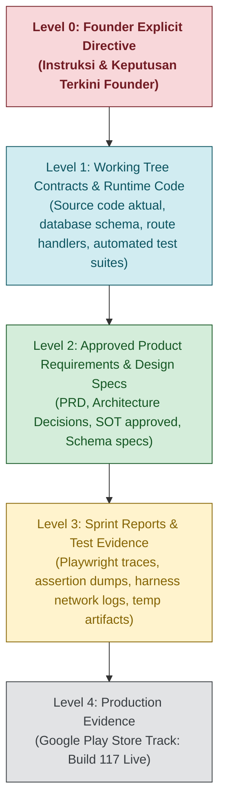

# BHUMI AMARTYA — SOURCE OF TRUTH (SoT) INDEX

**Document ID:** `SOT-INDEX-001`  
**Current Workstream:** Build 118 — Personal Weekly Cosmic & Soul Guidance  
**Baseline Git Branch:** `hotfix/build110-indonesian-only`  
**Target Build:** **BUILD 118** (`versionCode = 118`, `versionName = "5.0.18"`)  
**Production Baseline:** Build 117 (`versionCode = 117`, `versionName = "5.0.17"`, Active on Google Play Store)  
**Last Updated:** 28 Oktober 2026  
**Status:** ACTIVE AUDITED BASELINE  

---

## 1. HIERARKI PENENTUAN SUMBER KEBENARAN (SoT HIERARCHY)

Apabila ditemukan inkonsistensi atau pertentangan informasi antar-dokumen, seluruh agent dan developer wajib mematuhi hierarki otoritas berikut:

### Aturan Resolusi Konflik:
1. **Founder Explicit Directive Memimpin:** Keputusan Founder pada task aktif menjadi hukum tertinggi.
2. **Build 117 Baseline Aman:** Build 117 sudah rilis di Google Play Store. Pengembangan fitur Panduan Minggu Ini adalah **BUILD 118** (`versionCode = 118`, `versionName = "5.0.18"`).
3. **Source Code & Runtime Guard Mengalahkan Dokumen Statis:** Dokumen requirements yang menyatakan suatu fitur "selesai" tidak berlaku jika source code atau test suite membuktikan sebaliknya.
4. **No Generic Astrological Reading:** Penggunaan data astrologi natal (Sun, Moon, Ascendant, Placidus houses, planetary placements) wajib dihitung secara nyata, bukan menggunakan bahasa bersyarat generik.

---

## 2. INVENTARIS DOKUMEN SoT & STATUS SIKLUS HIDUP

| Nama Dokumen | Path Repositori | Status | Fungsi Utama & Cakupan |
|---|---|---|---|
| **SOT_INDEX.md** | `docs/sot/SOT_INDEX.md` | **ACTIVE** | Peta hierarki otoritas dan indeks dokumen repositori. |
| **PROJECT_REQUIREMENTS_MATRIX.md** | `docs/requirements/PROJECT_REQUIREMENTS_MATRIX.md` | **ACTIVE** | Matriks kepatuhan persyaratan produk dan verifikasi acceptance. |
| **MASTER_TODO.md** | `docs/tracking/MASTER_TODO.md` | **ACTIVE** | Backlog dan pelacakan pekerjaan aktif lintas workstream. |
| **SPRINT_REGISTER.md** | `docs/tracking/SPRINT_REGISTER.md` | **ACTIVE** | Ledger resmi riwayat sprint dan hasil pengujian lokal. |
| **DECISION_LOG.md** | `docs/tracking/DECISION_LOG.md` | **ACTIVE** | Catatan keputusan arsitektur dan mandat Founder (ADR). |
| **RISK_REGISTER.md** | `docs/tracking/RISK_REGISTER.md` | **ACTIVE** | Register manajemen risiko teknis dan mitigasi fail-closed. |
| **EVIDENCE_REGISTER.md** | `docs/tracking/EVIDENCE_REGISTER.md` | **ACTIVE** | Register bukti pengujian otomatis dan assertion traces. |
| **PATCH_MANIFEST.json** | `docs/tracking/PATCH_MANIFEST.json` | **ACTIVE** | Manifest integritas berkas termodifikasi pada working tree. |

---

## 3. SOURCE-TO-IMPLEMENTATION MAPPING (BUILD 118 WEEKLY COSMIC GUIDANCE)

| Domain Kontrak | File Dokumen / Spesifikasi | File Implementasi Aktual (Working Tree) | Status Implementasi |
|---|---|---|---|
| **ISO-8601 Week Boundaries** | Founder Directive §8 | `lib/weeklyGuidance/weeklyTransitCalculator.ts` (`computeWeeklyTimeWindow`) | **IMPLEMENTED** (Luxon ISO week number, anti-collision `YYYY-WXX`) |
| **Collective Sky Weather** | Founder Directive §2 | `lib/weeklyGuidance/weeklyTransitCalculator.ts` (`calculateWeeklyCollectiveSky`) | **IMPLEMENTED** (SwissEph Apparent, Moon Phase & Illumination, 8 Planet Motions, Real Stations/Ingresses) |
| **Placidus Natal Transits** | Founder Directive §3 | `lib/weeklyGuidance/weeklyTransitCalculator.ts` (`calculateTransitToNatalAspects`) | **IMPLEMENTED** (Placidus cusps, Cusp Crossing detection, 5 Major Aspects, Orb, Applying/Exact/Separating) |
| **8 Life Domains Synthesis** | Founder Directive §4 | `lib/weeklyGuidance/weeklyGuidanceEngine.ts` (`buildWeeklyGuidance`) | **IMPLEMENTED** (8 domain mapping, proportional scoring Kuat/Sedang/Ritme Tenang, distinct 1-sentence summaries) |
| **Canonical Blueprint Depth** | Founder Directive §5, §8 | `lib/weeklyGuidance/weeklyGuidanceEngine.ts` (`synthesizeDomainInterpretation`) | **IMPLEMENTED** (Multi-arcana Karmic Tail 21-7-13, Love Path 7-10-21, BaZi, Vedic Lagna/Dasha, HD Centers/Authority, Numerology) |
| **Relationship Status Adaptation** | Founder Directive §8, §9 | `lib/weeklyGuidance/weeklyGuidanceEngine.ts` `app/settings/page.tsx` | **IMPLEMENTED** (Single, Berpasangan, Unspecified adaptation for Asmara & Percintaan domain) |
| **Exact Aspect Peak Timing** | Founder Directive §10 | `lib/weeklyGuidance/weeklyTransitCalculator.ts` | **IMPLEMENTED** (14 sub-interval zero-crossing bisection, labeled with 'sekitar' WIB, Moon traversal vs snapshot house) |
| **Spiritual & Psychological Safety**| Founder Directive §6 | `lib/weeklyGuidance/weeklyGuidanceEngine.ts` | **IMPLEMENTED** (Deep soul journey, shadow work, strict anti-psychiatric diagnosis & no curse fearmongering) |
| **Dashboard Cosmic Summary** | Founder Directive §7 | `components/dashboard/DashboardClient.tsx` (section.weekly) | **IMPLEMENTED** (Date range, collective theme, active transit card, top 3 highlighted domains, main spiritual message) |
| **8-Domain Mobile Experience** | Founder Directive §7, §8 | `components/dashboard/WeeklyGuidanceCard.tsx` | **IMPLEMENTED & FROZEN** (8 vertical full-width accordion cards, distinct summary preview, no horizontal scroll, advice box) |
| **State Reset & Loop Guard** | Founder Directive §8 | `components/dashboard/DashboardClient.tsx` (lines 176-202) | **IMPLEMENTED** (setWeeklyGuidance reset on UID change, removed 30s re-render loop) |
| **Temporal Blueprint Cycles** | Founder Directive §10 | `lib/destiny-matrix/annualArcana.ts` `lib/weeklyGuidance/weeklyGuidanceEngine.ts` | **IMPLEMENTED** (resolveDestinyMatrixArcanaAtAge from canonical graph nodes BM01-BM22) |
| **Telemetry & Idempotency** | Founder Directive §10 | `lib/analytics/usageAnalytics.ts` `lib/repositories/analyticsRepository.ts` | **IMPLEMENTED** (3000ms deduplication, ALREADY_EXISTS idempotent soft-warning, dev-to-prod Open Risk documented) |
| **Build 118 Versioning** | Founder Directive §10 | `android/app/build.gradle` `lib/config/buildInfo.ts` | **IMPLEMENTED** (`versionCode = 118`, `versionName = "5.0.18"`) |

---

## 4. REKONSILIASI KONFLIK VERSI (BUILD 117 s/d BUILD 118)

| Komponen Metadata | Nilai di File Statis | Nilai di Active Git / Target | Status Rekonsiliasi |
|---|---|---|---|
| **App Version (Android)** | `versionCode 117`, `"5.0.17"` | `versionCode 118`, `"5.0.18"` | Diselaraskan secara atomik di `build.gradle` dan `buildInfo.ts`. |
| **Semver package.json** | `"version": "4.4.5"` | `"version": "4.4.5"` | **Decoupled by mandate**: npm semver sengaja dipisahkan dari rilis Android native. |
| **Release Baseline** | Build 117 (Google Play Store) | Build 118 (Target Local Staging) | Build 117 adalah rilis produksi lama. Seluruh pengembangan mingguan baru menjadi Build 118. |
| **Rute Karantina** | 3 rute uji | `tests/harness/routes/` | Tiga rute uji (`test-3d-poc`, `test-astro-transit`, `test-identitas-inti`) tetap aman terkarantina di luar `app/`. |
