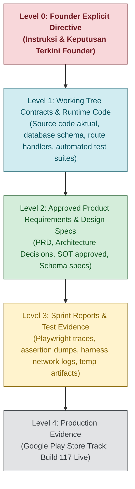

# BHUMI AMARTYA — SOURCE OF TRUTH (SoT) INDEX

> **Current Founder Decision — 2026-11-07, Build 120 / Release 5.0.20:**
> - **Build 120 Scope Completed & Verified:**
>   - Dashboard Memorial Footer: Dedication to Sheina Khazmalia (17 Oktober 1988 – 5 November 2026).
>   - Dashboard Daily Insight Parity: Aligned with Profile "Catatan Hari Ini → Arah Hari Ini" via shared `dailyDirection.paragraphs`, duplicate greeting removed, and "SATU TINDAKAN" removed.
>   - Natal Chart Lilith: Corrected IAU/ELP 2000-82 lunar mean apogee calculation (Founder chart verified Aries 26°47′, House 3; global parity across 15 synthetic fixtures PASS).
>   - BaZi & Vedic Recovery: In-memory local calculation restored for complete legacy profiles without requiring canonical server revisions; UID authentication fail-closed preserved.
>   - 11 Blueprints: Zero regression verified across all 11 core engines (BP01–BP11).
>   - Setup/Settings Fallback: Server metadata & lifetime access fields stripped; canonical profiles immutably guarded against rogue client birth mutations.
> - **Release AAB Assembly:** `com.bhumiamartya.app` (versionCode 120, versionName 5.0.20) built and officially signed with the official Bhumi Amartya release key (`CN=Bhumi Amartya, O=Bhumi Amartya, C=ID`). Fresh Next.js static web export (78 routes) and Capacitor sync verified.
> - **QA Status:** Localhost runtime verified & accepted by Founder. Physical Android device QA waived by Founder directive (`WAIVED_BY_FOUNDER`).
> - **Pending Infrastructure (Blocked from Production Deployment):** Cloudflare Workers POC, Vercel Billing Verifier, and production Firestore Rules hardening remain deferred locally to protect compatibility with active Play Store release 119. Google Play upload held pending explicit Founder directive (`PLAY_UPLOAD = NOT_PERFORMED`).

> **Current Founder decision — 2026-11-03, Build 126 / Release 119:** BP03 result-contract work is closed for the local baseline. Repository TypeScript, Build 115 regression, live normalizer and BP03 result contract are accepted PASS; HD legacy compatibility is PARTIAL pending browser QA. Preserve the verified engines, provenance, repository guards, regressions and recovery behavior; reopen BP03 only for a newly reproduced defect. Release 119 remains BLOCKED. Earlier status entries below are historical snapshots.

> **BP10 local integration evidence:** AuthProvider now checks versioned snapshots against an authenticated canonical read; a synthetic Chromium component run passed A → B → delayed A → C and forged snapshot controls. This is not Settings-to-emulator E2E. The integrated race and BP10 freeze remain unresolved; see `RELEASE119_BP10_FINAL_INTEGRATION_RESULT.md`.

> **Blueprint local evidence — BP06:** BaZi now recomputes from the same-user, versioned profile accepted by AuthProvider instead of persisted Blueprint inputs/results. A local Auth/Functions/Firestore emulator run passed 12 checks for the actual canonical save adapter, receipt, canonical read and actual BaZi hook, with a synthetic provider context; candidate Rules denied tested forgeries and cross-account read. Results are not persisted. This is not full application integration or global writer/Rules closure; Release 119 remains blocked.

> **Blueprint local evidence — BP07:** Vedic now recomputes from the accepted same-user canonical profile. A local emulator run passed 16 groups covering canonical commits, receipt, actual BP06/BP07 hooks with a synthetic provider context, revision conflict and tested cross-account/forgery controls. Canonical reads now explicitly reject a mismatched `profileUid`. Setup/Settings full Blueprint writes and browser integration remain unresolved; no global persistence or Rules PASS is implied.

> **Setup/Settings local source — 2026-11-03:** authenticated Settings now separates canonical receipt from the existing profile-preference repository and does not write a full client-derived Blueprint. Local emulator exercised the canonical adapter and actual preference repository, with synthetic accounts. Setup reports a confirmed profile save but remains incomplete while persisted Blueprint consumers lack a trusted replacement. Browser integration, full consumer compatibility and HD trusted persistence remain blocked; see `RELEASE119_SETUP_SETTINGS_SAFE_PERSISTENCE_RESULT.md`.

> **Setup readiness update — 2026-11-03:** Setup now verifies server profile, canonical revision and receipt before navigating; login and route predicate use canonical readiness, and the dashboard can calculate a nonpersisted view. Synthetic route checks and authenticated local emulator readiness checks passed; actual Setup navigation/reload in a browser and broad consumer compatibility remain unverified. Release 119 remains blocked; see `RELEASE119_SETUP_CANONICAL_READINESS_RESULT.md`.

> **Human Design persistence — 2026-11-04:** client Blueprint writers now reject payloads containing Human Design; default recovery does not persist a client-supplied result. Local Rules protect HD and canonical revision metadata; 15 Auth/Firestore emulator groups passed, including owner read, forged writes, cross-account denial and non-destructive recovery. The HD consumer uses the accepted canonical profile where available; an isolated synthetic Chromium test passed seven checks. No independently verified server HD writer exists; verified-result persistence and full Blueprint compatibility remain blocked. Existing pre-protection records still require provenance assessment. No Rules deployment is implied.

> **Mixed Blueprint update — 2026-11-04:** the two existing client writers can now save non-HD changes when supplied HD and birth input match stored values; neither protected field is written. A strictly empty legacy pending placeholder is also accepted when no HD is stored (unit evidence). Current-local-Rules emulator tests passed 20 isolated-module groups, and the candidate emulator passed 27 groups including the HD dismissal preference. Full application QA remains blocked. New usable or changed HD and changed input remain rejected; the stricter candidate still blocks arbitrary derived Blueprint writes. Trusted HD persistence and global compatibility remain blocked; see `RELEASE119_HD_PERSISTENCE_DEPENDENCY_RESULT.md`.

**Document ID:** `SOT-INDEX-001`  
**Current Workstream:** Build 119 - BP02 Destiny Matrix (BP02 ACTIVE; scope-locked)  
**Baseline Git Branch:** `hotfix/build110-indonesian-only`  
**Target Build:** **BUILD 119** (IN PROGRESS — NOT PRODUCTION READY; tidak ada promosi/hardcode selama belum Founder-accept)  
**Production Baseline:** Build 118 (`versionCode = 118`, `versionName = "5.0.18"`, commit `41e89d8d`) — TIDAK dipromosikan ke Build 119  
**Last Updated:** 31 Oktober 2026 (Sinkronisasi BP02)  
**Status:** ACTIVE — BP02 SCOPE-LOCKED (holding Build 118 baseline)  

---

## 1. HIERARKI PENENTUAN SUMBER KEBENARAN (SoT HIERARCHY)

Apabila ditemukan inkonsistensi atau pertentangan informasi antar-dokumen, seluruh agent dan developer wajib mematuhi hierarki otoritas berikut:

### Aturan Resolusi Konflik:
1. **Founder Explicit Directive Memimpin:** Keputusan Founder pada task aktif menjadi hukum tertinggi.
2. **Build 117 Baseline Aman:** Build 117 sudah rilis di Google Play Store. Pengembangan fitur Panduan Minggu Ini adalah **BUILD 118** (`versionCode = 118`, `versionName = "5.0.18"`).
3. **Source Code & Runtime Guard Mengalahkan Dokumen Statis:** Dokumen requirements yang menyatakan suatu fitur "selesai" tidak berlaku jika source code atau test suite membuktikan sebaliknya.
4. **No Generic Astrological Reading:** Penggunaan data astrologi natal (Sun, Moon, Ascendant, Placidus houses, planetary placements) wajib dihitung secara nyata, bukan menggunakan bahasa bersyarat generik.

---

## 2. INVENTARIS DOKUMEN SoT & STATUS SIKLUS HIDUP

| Nama Dokumen | Path Repositori | Status | Fungsi Utama & Cakupan |
|---|---|---|---|
| **SOT_INDEX.md** | `docs/sot/SOT_INDEX.md` | **ACTIVE** | Peta hierarki otoritas dan indeks dokumen repositori. |
| **PROJECT_REQUIREMENTS_MATRIX.md** | `docs/requirements/PROJECT_REQUIREMENTS_MATRIX.md` | **ACTIVE** | Matriks kepatuhan persyaratan produk dan verifikasi acceptance. |
| **MASTER_TODO.md** | `docs/tracking/MASTER_TODO.md` | **ACTIVE** | Backlog dan pelacakan pekerjaan aktif lintas workstream. |
| **SPRINT_REGISTER.md** | `docs/tracking/SPRINT_REGISTER.md` | **ACTIVE** | Ledger resmi riwayat sprint dan hasil pengujian lokal. |
| **DECISION_LOG.md** | `docs/tracking/DECISION_LOG.md` | **ACTIVE** | Catatan keputusan arsitektur dan mandat Founder (ADR). |
| **RISK_REGISTER.md** | `docs/tracking/RISK_REGISTER.md` | **ACTIVE** | Register manajemen risiko teknis dan mitigasi fail-closed. |
| **EVIDENCE_REGISTER.md** | `docs/tracking/EVIDENCE_REGISTER.md` | **ACTIVE** | Register bukti pengujian otomatis dan assertion traces. |
| **PATCH_MANIFEST.json** | `docs/tracking/PATCH_MANIFEST.json` | **ACTIVE** | Manifest integritas berkas termodifikasi pada working tree. |

---

## 3. SOURCE-TO-IMPLEMENTATION MAPPING (BUILD 118 WEEKLY COSMIC GUIDANCE)

| Domain Kontrak | File Dokumen / Spesifikasi | File Implementasi Aktual (Working Tree) | Status Implementasi |
|---|---|---|---|
| **ISO-8601 Week Boundaries** | Founder Directive §8 | `lib/weeklyGuidance/weeklyTransitCalculator.ts` (`computeWeeklyTimeWindow`) | **IMPLEMENTED** (Luxon ISO week number, anti-collision `YYYY-WXX`) |
| **Collective Sky Weather** | Founder Directive §2 | `lib/weeklyGuidance/weeklyTransitCalculator.ts` (`calculateWeeklyCollectiveSky`) | **IMPLEMENTED** (SwissEph Apparent, Moon Phase & Illumination, 8 Planet Motions, Real Stations/Ingresses) |
| **Placidus Natal Transits** | Founder Directive §3 | `lib/weeklyGuidance/weeklyTransitCalculator.ts` (`calculateTransitToNatalAspects`) | **IMPLEMENTED** (Placidus cusps, Cusp Crossing detection, 5 Major Aspects, Orb, Applying/Exact/Separating) |
| **8 Life Domains Synthesis** | Founder Directive §4 | `lib/weeklyGuidance/weeklyGuidanceEngine.ts` (`buildWeeklyGuidance`) | **IMPLEMENTED** (8 domain mapping, proportional scoring Kuat/Sedang/Ritme Tenang, distinct 1-sentence summaries) |
| **Canonical Blueprint Depth** | Founder Directive §5, §8 | `lib/weeklyGuidance/weeklyGuidanceEngine.ts` (`synthesizeDomainInterpretation`) | **IMPLEMENTED** (Multi-arcana Karmic Tail 21-7-13, Love Path 7-10-21, BaZi, Vedic Lagna/Dasha, HD Centers/Authority, Numerology) |
| **Relationship Status Adaptation** | Founder Directive §8, §9 | `lib/weeklyGuidance/weeklyGuidanceEngine.ts` `app/settings/page.tsx` | **IMPLEMENTED** (Single, Berpasangan, Unspecified adaptation for Asmara & Percintaan domain) |
| **Exact Aspect Peak Timing** | Founder Directive §10 | `lib/weeklyGuidance/weeklyTransitCalculator.ts` | **IMPLEMENTED** (14 sub-interval zero-crossing bisection, labeled with 'sekitar' WIB, Moon traversal vs snapshot house) |
| **Spiritual & Psychological Safety**| Founder Directive §6 | `lib/weeklyGuidance/weeklyGuidanceEngine.ts` | **IMPLEMENTED** (Deep soul journey, shadow work, strict anti-psychiatric diagnosis & no curse fearmongering) |
| **Dashboard Cosmic Summary** | Founder Directive §7 | `components/dashboard/DashboardClient.tsx` (section.weekly) | **IMPLEMENTED** (Date range, collective theme, active transit card, top 3 highlighted domains, main spiritual message) |
| **8-Domain Mobile Experience** | Founder Directive §7, §8 | `components/dashboard/WeeklyGuidanceCard.tsx` | **IMPLEMENTED & FROZEN** (8 vertical full-width accordion cards, distinct summary preview, no horizontal scroll, advice box) |
| **State Reset & Loop Guard** | Founder Directive §8 | `components/dashboard/DashboardClient.tsx` (lines 176-202) | **IMPLEMENTED** (setWeeklyGuidance reset on UID change, removed 30s re-render loop) |
| **Temporal Blueprint Cycles** | Founder Directive §10 | `lib/destiny-matrix/annualArcana.ts` `lib/weeklyGuidance/weeklyGuidanceEngine.ts` | **IMPLEMENTED** (resolveDestinyMatrixArcanaAtAge from canonical graph nodes BM01-BM22) |
| **Telemetry & Idempotency** | Founder Directive §10 | `lib/analytics/usageAnalytics.ts` `lib/repositories/analyticsRepository.ts` | **IMPLEMENTED** (3000ms deduplication, ALREADY_EXISTS idempotent soft-warning, dev-to-prod Open Risk documented) |
| **Build 118 Versioning** | Founder Directive §10 | `android/app/build.gradle` `lib/config/buildInfo.ts` | **IMPLEMENTED** (`versionCode = 118`, `versionName = "5.0.18"`) |

---

## 4. REKONSILIASI KONFLIK VERSI (BUILD 117 s/d BUILD 118)

| Komponen Metadata | Nilai di File Statis | Nilai di Active Git / Target | Status Rekonsiliasi |
|---|---|---|---|
| **App Version (Android)** | `versionCode 117`, `"5.0.17"` | `versionCode 118`, `"5.0.18"` | Diselaraskan secara atomik di `build.gradle` dan `buildInfo.ts`. |
| **Semver package.json** | `"version": "4.4.5"` | `"version": "4.4.5"` | **Decoupled by mandate**: npm semver sengaja dipisahkan dari rilis Android native. |
| **Release Baseline** | Build 117 (Google Play Store) | Build 118 (Target Local Staging) | Build 117 adalah rilis produksi lama. Seluruh pengembangan mingguan baru menjadi Build 118. |
| **Rute Karantina** | 3 rute uji | `tests/harness/routes/` | Tiga rute uji (`test-3d-poc`, `test-astro-transit`, `test-identitas-inti`) tetap aman terkarantina di luar `app/`. |

---

## 5. BUILD 119 — BP02 DESTINY MATRIX (ACTIVE WORKSTREAM; SCOPE-LOCKED)

**Status Build 119:** `IN PROGRESS — NOT PRODUCTION READY`. Build 118 tetap production baseline (no promotion). Tanpa commit/push/deploy/migration.

### 5.1 Posisi SoT untuk BP02

* **Engine canonical (FROZEN read-only):** `lib/engines/destinyMatrixGraph.ts`, `lib/engines/calculateBhumiMatrix.ts`, `lib/engines/destinyMatrixBlueprintAdapter.ts`, `lib/destiny-matrix/{topology,ancestralProjection,annualArcana}.ts`, `lib/data/destinyMatrixArcanaDictionary.ts` (nama 22 Arcana tetap English; interpretasi Bahasa Indonesia natural dengan sapaan "kamu").
* **Keputusan arsitektur konten (PROPOSAL, menunggu Founder Review):** `BUILD119_OPENCODE_BP02_B_DESTINY_MATRIX_CONTENT_ARCHITECTURE_REPORT.md` (D-B-1..D-B-8).
* **Keputusan audit BP02-A (COMPLETE — READY WITH FOUNDER DECISIONS):** `BUILD119_OPENCODE_BP02_A_DESTINY_MATRIX_COMPLETE_AUDIT_REPORT.md` (D-02-1..D-02-4).
* **Master audit DASH-05/06 (historical):** tetap referensi untuk analisis dampak konsumen (blast radius).

### 5.2 Kontrak Pekerjaan BP02 (dari scope-lock Founder 31 Okt 2026)

* **Diizinkan:** audit & arsitektur konten Destiny Matrix; interpretasi 22 Arcana; Arcana Center & pola utama; Higher Talent & angka penyusunnya; Talent/Karma Father & Mother berdasar posisi canonical; Karmic Tail, Past Life, jabatan arketipal, indikator resonansi pola; Love & Money Line; Purpose Channel; Personal Health Card (7 chakra; Physics/Energy/Emotions; Luber/Block/Selaras; sintesis); Arcana Tahunan & siklus usia; Kesimpulan perjalanan jiwa; validasi UID ownership/freshness/determinism/isolasi data khusus Destiny Matrix; pembaruan governance docs sebatas entri BP02.
* **Dilarang:** BP01 (termasuk D6 yang masih berjalan), BP03 Human Design, BP04–BP11, dashboard/guidance system, shared calculators/engines/translators, Firebase Auth/Firestore Rules/schema/billing/Premium, komponen global/config/dependensi bersama tanpa persetujuan terpisah (laporkan dependency & blast radius dulu).
* **Data Isolation:** setiap hasil Destiny Matrix dari input valid pengguna aktif; diuji dua UID berbeda, logout, account switching, stale data, request race; tidak boleh ada pembacaan milik pengguna lain.
* **Governance:** hanya progres BP02 yang terdokumentasi; status Blueprint lain tidak berubah kecuali dependency note; Build 119 tetap IN PROGRESS; tidak ada FROZEN/CLOSED tanpa Founder Acceptance.
* **Current phase:** BP02-C Premium UI/UX Proposal — DESAIN PROPOSAL SAJA (`BUILD119_OPENCODE_BP02_C_PREMIUM_DESTINY_MATRIX_UI_UX_PROPOSAL.md`, menunggu Founder Review); D-B-8 resolved = Option A (Health Card angka canonical engine — ADR-DM-04); D-B-1..7 & D-02-1..4 tetap pending; belum ada izin implementasi BP02-D1–D6.

### 5.3 Kebijakan Permanen Terintegrasi (Build 119 → 120+)

* **Permanent Continuous Governance (ADR-DM-02):** 7-langkah sprint gates (Preflight → Implementation → Verification → Documentation Sync → Traceability → Status Control → Founder Gate); traceability `Requirement ID → Sprint → Source Change → Test Evidence → Founder Decision → Final Status`; saat Build 120 dimulai wajib disusun `BUILD119_TO_BUILD120_READINESS_AND_GAP_REPORT.md`.
* **Permanent User Data Isolation & Personalization (ADR-DM-03):** bahkan untuk BP02-scope saat ini: PRM seksi 25 (BP02-ISO-01..06); tidak ada BP02 FROZEN/CLOSED sebelum semua isu lolos acceptance.
* **Master Tracking sinkron:** `docs/tracking/MASTER_TODO.md` §5; `docs/tracking/SPRINT_REGISTER.md` (BP02-A/B); `docs/requirements/PROJECT_REQUIREMENTS_MATRIX.md` sek. 24–25; `docs/tracking/DECISION_LOG.md` ADR-DM-01..03; `docs/tracking/RISK_REGISTER.md` RSK-35..38.

## 2026-11-03 — Build 126 profile revision design addendum (PROPOSED)

Founder-authorized design only: `BUILD126_SHARED_PROFILE_AUTHORITATIVE_REVISION_AND_PERSISTENCE_ACK_DESIGN.md`. Shared profile freshness and truthful persistence acknowledgment remain Release 119 blockers; BP10 local freeze remains BLOCKED. The preferred server-owned revision/receipt strategy is a proposal pending Founder and security review, not an implemented or approved schema. Release 120 retains broader Security & Authorization and Billing after Release 119 completion. Historical entries above are preserved; current Founder directives control.

## 2026-11-03 — Final profile revision direction (design gate)

Founder approved trusted authority/CAS/idempotent-ack architectural direction, design only. `BUILD126_PROFILE_REVISION_FINAL_IMPLEMENTATION_SECURITY_AND_LEGACY_DESIGN.md` recommends NEW_SERVER_REVISION; no schema, Rules, source or deployment implementation is authorized. Legacy-client migration and minimum security design remain BLOCKED; BP10 freeze and Release 119 readiness remain BLOCKED. Earlier entries remain historical.

## 2026-11-03 — Profile revision Phase A local stop

Conditional implementation stopped at writer/legacy/trusted-boundary gate. Synthetic emulator of the current local Rules allowed owner unversioned birth writes and arbitrary revision-like field; cross-account control was denied. This is not a Rules candidate or production evidence. BP10 freeze and Release 119 readiness remain BLOCKED; details: `BUILD126_PROFILE_REVISION_SERVER_CONTRACT_LOCAL_IMPLEMENTATION_REPORT.md`.

### 2026-11-03 — Build 126 current baseline and profile boundary

Founder accepts current worktree snapshot as baseline; historical 72-path reconstruction is waived. Candidate callable has partial synthetic emulator evidence, but Rules bypass and integrated freshness remain blocked. See BUILD126_RELEASE119_CURRENT_BASELINE_AND_PROFILE_IMPLEMENTATION_REPORT.md. Production remains unverified.

### 2026-11-03 — Build 126 profile security closure

Build 126 local Rules closure candidate and negative controls were tested in synthetic emulators; Phase A remains blocked by missing trusted Blueprint writer replacement and incomplete callable initialization/receipt security. BP10 integration and production remain unverified. See BUILD126_RELEASE119_PROFILE_SECURITY_CLOSURE_AND_BP10_INTEGRATION_REPORT.md.

### 2026-11-03 — Build 126 Blueprint writer prototype

Build 126 isolated trusted Blueprint input prototype has scoped synthetic callable evidence; source remains unintegrated, computed output provenance and profile initialization unresolved. Phase A and BP10 remain blocked. See BUILD126_RELEASE119_TRUSTED_BLUEPRINT_WRITER_AND_PROFILE_CONTRACT_CLOSURE_REPORT.md.

### 2026-11-03 — Build 126 Phase A security integration

Build 126 candidate Rules now restrict client Blueprint writes to status metadata; local negative control showed forged Human Design accepted before and denied after. Legitimate result writer, Functions entrypoint, legacy initialization and Phase A remain blocked. See BUILD126_RELEASE119_PHASE_A_FINAL_SECURITY_AND_BP10_INTEGRATION_REPORT.md.

### 2026-11-03 — Build 126 Functions integration recovery

Build 126 Phase A integration remains blocked: actual Functions entrypoint imports three absent local modules whose source was not found in available repository history. No stub, deployment or Phase B integration. See BUILD126_RELEASE119_FUNCTIONS_BLUEPRINT_WRITER_AND_PROFILE_INTEGRATION_CLOSURE_REPORT.md.

### 2026-11-03 — Build 126 local Functions continuation

Build 126 local combined Functions emulator entrypoint verified a scoped canonical callable and 21 synthetic checks; main Functions entrypoint remains blocked by missing source modules. Legacy alias preservation, legitimate Blueprint path, shared freshness and release remain blocked. See BUILD126_RELEASE119_FUNCTIONS_RECOVERY_AND_TRUSTED_PROFILE_CONTINUATION_REPORT.md.

### 2026-11-03 — Build 126 profile alias integration gate

Build 126 local profile initialization now rejects conflicting birth aliases and avoids rewriting legacy birth fields; 27 synthetic callable checks passed. Complete retry/alias coverage, Blueprint writer/consumer and BP10 integration remain blocked; main Functions source remains unavailable. See BUILD126_RELEASE119_LOCAL_PROFILE_BLUEPRINT_AND_BP10_INTEGRATION_REPORT.md.

### 2026-11-03 — Build 126 profile and Blueprint integration gates

Build 126 local profile callable supports tested nested-only legacy initialization and deterministic city/place label comparison; 33 synthetic emulator checks pass. Retry across real timeouts, trusted Blueprint consumers and BP10 integration remain blocked. See BUILD126_RELEASE119_CANONICAL_PROFILE_BP10_AND_BLUEPRINT_E2E_CLOSURE_REPORT.md.

### 2026-11-03 — Build 126 application save integration

Build 126 Settings now reuses a session-scoped hashed pending request identity and retries uncertain profile commits without synthesizing receipts. Actual shared freshness/BP10 and trusted Blueprint flow remain blocked; selected Build 115 regression has four failures. See BUILD126_RELEASE119_ACTUAL_APPLICATION_INTEGRATION_REPORT.md.

### 2026-11-03 — Build 126 shared profile and HD triage

Build 126 AuthProvider now rejects unversioned replacement after an accepted revision and guards obsolete refresh/session completions. Six synthetic Chromium checks mounted the actual provider and BP10 page; full emulator-to-Settings-to-BP10 proof remains blocked. Four Build 115 tests remain failing. See BUILD126_RELEASE119_SHARED_PROFILE_BP10_AND_HD_REGRESSION_CLOSURE_REPORT.md.

### 2026-11-03 — Build 126 Settings provider integration

Build 126 Settings now verifies the server receipt and asks AuthProvider to read the canonical record; synthetic callable/provider checks pass, but full browser flow hits QA_RUNTIME_DISABLED and remains unverified. No BP10 freeze or release approval. See BUILD126_RELEASE119_SETTINGS_AUTHPROVIDER_BP10_INTEGRATED_E2E_REPORT.md.

### 2026-11-03 — Build 126 QA runtime and HD token evidence

Build 126 QA runtime gate explicitly rejects the combined Auth/Functions emulator mode; existing guard suite passed 538 synthetic assertions. An emulator-issued token passed the actual HD transport with a synthetic endpoint, but Build 115 suite and BP10 integrated browser remain blocked. See BUILD126_RELEASE119_QA_RUNTIME_AND_BP10_TRUE_E2E_CLOSURE_REPORT.md.

### 2026-11-03 — Build 126 OpenCode QA reconciliation

Build 126 OpenCode QA candidate was reconciled: qaOnly runtime is fail-closed pending immutable build isolation; configuration-only validation is explicitly non-authorizing. Current synthetic guard suite passes 568 assertions. BP10 E2E/release remain blocked. See BUILD126_OPENCODE_QA_GUARD_RECONCILIATION_REPORT.md.

### 2026-11-03 — Build 126 QA build isolation execution gate

QA-only runtime and BP10 integrated E2E remain blocked: independently verified build identity and production artifact isolation are absent. Guard 568/538, standalone helper 42 and BP10 math 6,948/1,444 passed locally; the old freshness probe failed against the current fail-closed save contract. See BUILD126_RELEASE119_QA_BUILD_ISOLATION_AND_TRUE_BP10_E2E_REPORT.md. No feature freeze or release approval.

### 2026-11-03 — Build 126 freshness probe reconciliation

The old helper probe now verifies explicit failure and no subsequent Blueprint callback on rejected profile persistence: 10 checks passed. Actual isolated QA harness and BP10 integrated E2E remain blocked and unimplemented; no freeze recommendation. See BUILD126_RELEASE119_QA_HARNESS_EXECUTION_AND_BP10_E2E_ACCEPTANCE_REPORT.md.

### 2026-11-03 — Build 126 isolated QA login smoke

A dedicated local Next target started against three synthetic loopback emulators; actual login and Auth Emulator smoke passed (3 checks). Production artifact isolation and the full QA security contract remain blocked; BP10 E2E was not run. See BUILD126_RELEASE119_QA_HARNESS_IMPLEMENTATION_RESULT.md.

### 2026-11-03 — Build 126 QA security acceptance

Candidate Rules passed 13 scoped authenticated emulator checks and the actual login smoke passed. Process identity remains blocked on independent lineage and complete fallback evidence; production artifact isolation remains blocked because the isolated release build fails TypeScript. BP10 E2E not run. See BUILD126_RELEASE119_QA_SECURITY_ACCEPTANCE_AND_BP10_E2E_REPORT.md.

### 2026-11-03 — Build 126 owned QA stack and TypeScript progress

Owned local emulator stack, app-scope loopback and login smoke executed; continuous listener ownership and comprehensive browser egress isolation remain blocked, so BP10 E2E was not run. TypeScript improved from 18 to two Human Design status-contract diagnostics; repository TSC remains FAIL. See BUILD126_RELEASE119_QA_UNBLOCK_AND_BP10_INTEGRATED_EXECUTION_REPORT.md.

### 2026-11-03 — Build 126 launcher and browser boundary

Launcher IPC challenge, parent checks and periodic process/listener monitoring were exercised; owned Firestore termination closed the QA session. Chromium WebRTC bypassed HTTP interception; added browser defense-in-depth did not establish OS egress isolation. Local BP10 E2E remains blocked. Two protected Human Design status-contract TypeScript diagnostics remain. See BUILD126_RELEASE119_QA_SECURITY_AND_BP10_E2E_FINAL_CLOSURE_REPORT.md.

### 2026-11-03 — Build 126 offline namespace capability

A disposable WSL network namespace passed loopback and external TCP/UDP/DNS denial checks, but the actual app/emulators/Chromium were not run inside it and sandbox acceptance remains blocked. Two Human Design calculationStatus diagnostics remain unresolved; a separate existing live normalizer test failed. See BUILD126_RELEASE119_OFFLINE_QA_AND_BP10_E2E_REPORT.md.
