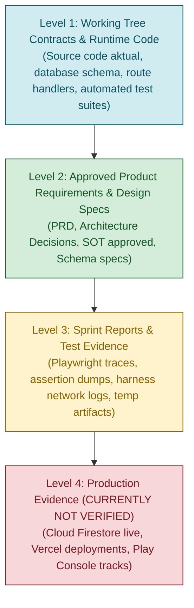

# BHUMI AMARTYA — SOURCE OF TRUTH (SoT) INDEX

**Document ID:** `SOT-INDEX-001`  
**Current Workstream:** Phase 1 — Human Design Stabilization  
**Baseline Git Branch:** `hotfix/build110-indonesian-only`  
**Active HEAD:** `e63f334cf0ac20cc076bc88e98e3e06808b024f3`  
**Last Updated:** 20 Oktober 2026  
**Status:** ACTIVE BASELINE  

---

## 1. HIERARKI PENENTUAN SUMBER KEBENARAN (SoT HIERARCHY)

Apabila ditemukan inkonsistensi atau pertentangan informasi antar-dokumen, seluruh agent dan developer wajib mematuhi hierarki otoritas berikut:

### Aturan Resolusi Konflik:
1. **Source Code & Runtime Guard Mengalahkan Dokumen Statis:** Dokumen requirements yang menyatakan suatu fitur "selesai" tidak berlaku jika source code atau test suite membuktikan sebaliknya.
2. **Tidak Mengambil Keputusan Sepihak:** Jika terdapat pertentangan substantif antar dokumen Level 2 atau antara Level 1 dan Level 2, catat konflik pada *SoT Conflict Register* dan eskalasikan ke Founder.
3. **Produksi Tetap NOT VERIFIED:** Laporan atau asumsi mengenai kondisi produksi tidak boleh dijadikan acuan tanpa bukti telemetri atau akses terverifikasi.

---

## 2. INVENTARIS DOKUMEN SoT & STATUS SIKLUS HIDUP

| Nama Dokumen | Path Repositori | Pemilik / Asal | Status | Fungsi Utama & Cakupan |
|---|---|---|---|---|
| **SOT.md** | `SOT.md` | Core Team (Build 80) | **OUTDATED** | Fondasi arsitektur awal aplikasi, aturan Firestore, Android API 36, dan standar enkripsi. Belum memuat perbaikan HD-01 s/d HD-05. |
| **V5_SOURCE_OF_TRUTH.md** | `V5_SOURCE_OF_TRUTH.md` | Product Lead (Build 100+) | **OUTDATED** | Rencana V5 untuk modularisasi multi-blueprint, comfort mode, daily rhythm, dan FCM. Menjadi acuan arah arsitektur tetapi bukan kontrak aktif Phase 1. |
| **SOURCE_OF_TRUTH_V4_SOUL_IDENTITY_SYSTEM.md** | `SOURCE_OF_TRUTH_V4_SOUL_IDENTITY_SYSTEM.md` | Astrological / Soul Engine Lead | **ACTIVE (PROTECTED)** | Spesifikasi domain astrologi, transit ephemeris SwissEph, numerologi, dan arketipe. Dilindungi dari mutasi selama Phase 1. |
| **TODO.md** | `TODO.md` | OpenCode / Antigravity | **ACTIVE (HYBRID)** | Berisi catatan aktif runner verification HD-05D.1, sekaligus mempertahankan jejak backlog historis Build 80 & 85. |
| **SCHEMA.md** | `SCHEMA.md` | Backend Lead | **ACTIVE** | Kontrak skema Firestore (`users`, `blueprints`, `dailyGuidance`, `behaviorMemory`). |
| **SECURITY.md** | `SECURITY.md` | Security Lead | **ACTIVE** | Kebijakan proteksi PII, credential leakage prevention, fail-closed auth, dan Firestore Rules. |
| **ARCHITECTURE.md** | `ARCHITECTURE.md` | System Architect | **ACTIVE** | Peta dependensi modul Next.js, Capacitor, Firebase, dan external computation bridges. |
| **PRD.md** | `PRD.md` | Product Management (Build 80) | **LEGACY** | Persyaratan produk awal. Telah disubstitusi oleh spesifikasi sprint dan `V5_PRD.md`. |
| **V5_PRD.md** | `V5_PRD.md` | Product Management (V5) | **ROADMAP** | Persyaratan fitur V5 masa depan. |

---

## 3. SOURCE-TO-IMPLEMENTATION MAPPING (HUMAN DESIGN WORKSTREAM)

Peta korespondensi antara kontrak teoritis dan implementasi aktual pada working tree:

| Domain Kontrak | File Dokumen / Spesifikasi | File Implementasi Aktual (Working Tree) | Status Implementasi |
|---|---|---|---|
| **Auth Gateway** | `SECURITY.md` §3 | `lib/auth/hdEndpointAuth.ts` `app/api/humandesign/calculate/route.ts` `app/api/humandesign/astrology/route.ts` | **IMPLEMENTED** (Fail-closed, Bearer token, AppCheck non-bypass) |
| **Bodygraph Decommission** | Sprint HD-01 Decision | `app/api/humandesign/bodygraph/route.ts` | **IMPLEMENTED** (HTTP 410 Gone) |
| **Core Completeness** | Sprint HD-02 Spec | `lib/humandesign/completeness.ts` `lib/humandesign/hdkitAdapter.ts` | **IMPLEMENTED** (9 centers, gates, channels, cross, profile, type) |
| **Birth Binding** | Sprint HD-03 Spec | `lib/humandesign/birthFingerprint.ts` | **IMPLEMENTED** (`bip_v1_<fnv1a32>` deterministic hash) |
| **Timezone & DST** | Sprint HD-03 Spec | `services/humandesign-api/main.py` (`parse_timezone_to_offset`) | **IMPLEMENTED** (IANA timezone string + historical DST) |
| **Deadlines & Transport** | Sprint HD-04 Spec | `lib/humandesign/hdCommunication.ts` | **IMPLEMENTED** (Client 25s, Proxy 15s, Error classifier) |
| **Recovery Executor** | Sprint HD-04 Spec | `lib/humandesign/hdRecovery.ts` `lib/repositories/blueprintRepository.ts` | **IMPLEMENTED** (Shared promise deduplication, stale write guard) |
| **Explicit UI States** | Sprint HD-05 Spec | `lib/humandesign/hdView.ts` `components/blueprint/HdStatus.tsx` `components/blueprint/HdStoredStatus.tsx` | **IMPLEMENTED** (`ready_canonical`, `pending`, `missing_blueprint`, `error`) |
| **In-Memory Cache** | Sprint HD-05 Spec | `lib/humandesign/hdLoad.ts` `lib/humandesign/hdRead.ts` | **IMPLEMENTED** (5-minute TTL, UID & revision scoped, no localStorage) |
| **Account Isolation** | Sprint HD-05D.1 Spec | `tests/helpers/hd05dFlowD.mjs` | **VERIFIED LOCAL BROWSER** (7/7 scenarios PASS, 104 checks) |
| **New User Onboarding** | Sprint HD-05D.2 Spec | `tests/helpers/hd05daFlowA.mjs` | **DRAFTED / NEXT SPRINT** (Ready for execution) |

---

## 4. REKONSILIASI KONFLIK VERSI (BUILD 80 s/d BUILD 110)

| Komponen Metadata | Nilai di File Statis | Nilai di Active Git / TODO | Status Rekonsiliasi |
|---|---|---|---|
| **App Version** | `4.4.5` (`package.json`) | `Build 110` (`hotfix/build110-indonesian-only`) | Terjadi akumulasi versioning. Versi `4.4.5` adalah versi semver di npm, sedangkan `Build 110` merujuk pada `versionCode` rilis Android. |
| **Worktree Referensi** | `bhumi-build83-access-hotfix` (`TODO.md` line 14) | `bhumi-build106-recovery` (Filesystem aktual) | Catatan `TODO.md` baris 14 adalah sisa teks Build 85 historis. Repositori kerja aktif yang sah adalah `C:\tmp\bhumi-build106-recovery`. |
| **Target SDK Android** | API 36 (`SOT.md`) | API 36 (`package.json` `@capacitor/android 8.3.4`) | Konsisten pada level spesifikasi dan dependensi. |
| **Founder Dashboard** | Tercampur di `/app/admin` (`TODO.md` line 109) | Terpisah di `C:\tmp\bhumi-founder-dashboard` | **RESOLVED BY MANDATE:** Founder Dashboard adalah repositori independen. Halaman `/admin` di repositori ini adalah legacy yang akan didekomisi. |

---

## 5. DAFTAR PERUBAHAN YANG MEMERLUKAN KEPUTUSAN FOUNDER

1. **Penyatuan / Cleanup `TODO.md`:** `TODO.md` saat ini merupakan dokumen hybrid yang memuat teks historis Build 80, Build 85, dan catatan Build 110. Diusulkan untuk mengarsipkan to-do lama ke `docs/archive/` setelah Phase 1 selesai.
2. **Migrasi FNV-1a 32-Bit:** Algoritma sidik jari input saat ini menggunakan FNV-1a 32-bit (`bip_v1`). Keputusan diperlukan apakah perlu di-upgrade ke 64-bit atau SHA-256 pada Phase 2.
3. **Pembersihan Rute `/admin`:** Keputusan final mengenai waktu penghapusan rute `/app/admin/**` dari repositori mobile ini.
4. **Otorisasi HD-06 & Release Gate:** Prosedur rilis dan verifikasi endpoint produksi Human Design di Railway/Vercel membutuhkan izin eksplisit Founder.
