# BHUMI AMARTYA — SPRINT REGISTER

**Document ID:** `SPRINT-REG-001`  
**Current Workstream:** Workstream 2 — Billing & Entitlement  
**Baseline Git Branch:** `hotfix/build110-indonesian-only`  
**Active HEAD:** `e63f334cf0ac20cc076bc88e98e3e06808b024f3`  
**Last Updated:** 21 Oktober 2026  
**Status:** ACTIVE REGISTER  

---

## 1. SPRINT RECORD TABLE

| Sprint ID | Nama Sprint & Cakupan | Outgoing / Incoming Agent | Tanggal Selesai Dilaporkan | Status Dilaporkan | Status Terverifikasi Aktual | Test Suite Utama | Bukti Pengujian (Evidence) | Blocker / Catatan |
|---|---|---|---|---|---|---|---|---|
| **HD-01** | Security & Authentication Gateway | OpenCode / Antigravity | 18 Okt 2026 | PASS LOCAL | **PASS LOCAL** | `tests/unit/hd-endpoint-auth.test.ts` | 12 unit tests PASS | Fail-closed token auth & route dekomisioning 410 terbukti. |
| **HD-02** | Canonical & Chart Structural Integrity | OpenCode / Antigravity | 18 Okt 2026 | PASS LOCAL | **PASS LOCAL** | `tests/unit/hd-canonical-integrity.test.ts` | 10 unit tests PASS | Acceptance predicate core complete lolos pengujian struktural. |
| **HD-03** | Birth Input Binding & Concurrency | OpenCode / Antigravity | 18 Okt 2026 | PASS LOCAL | **PASS LOCAL** | `tests/unit/hd-birth-binding.test.ts` `test_timezone_dst_standalone.py` | 10 TS tests PASS 7 Python tests PASS | Deterministic revision hash `bip_v1` & timezone DST lolos. |
| **HD-04** | Engine Reliability & Recovery | OpenCode / Antigravity | 18 Okt 2026 | PASS LOCAL | **PASS LOCAL** | `tests/unit/hd04-communication.test.ts` `tests/unit/hd04-scenarios.test.ts` | 13 comm tests PASS 20 scenario checks PASS | Deadlines, bounded retries, dan shared executor terbukti. |
| **HD-05** | UI Resilience & In-Memory Cache | OpenCode / Antigravity | 20 Okt 2026 | PASS LOCAL | **PASS LOCAL BROWSER** | `tests/unit/hd05-render-cache.test.ts` `tests/unit/hd05-view.test.ts` | 90 Unit & SSR tests PASS | Komponen UI, in-memory cache, dan 25 skenario acceptance browser lolos verifikasi. |
| **HD-05B** | Acceptance Gap Review | OpenCode / Antigravity | 18 Okt 2026 | COMPLETED | **COMPLETED** | Review Audit | Dokumen temuan gap | Menemukan regresi build107 & ketiadaan full browser harness. |
| **HD-05C** | Local Harness & Regression Repair | OpenCode / Antigravity | 19 Okt 2026 | PASS LOCAL | **PASS LOCAL** | `tests/helpers/hd05cLocalPlaywrightHarness.mjs` `hd-route-security.test.ts` | Harness smoke check PASS | Memperbaiki legacy regressions dan menyusun synthetic mocks. |
| **HD-05D.1** | Browser Acceptance Flow D (Account Isolation) | OpenCode / Antigravity | 19 Okt 2026 (01:40 WIB) | PASS LOCAL BROWSER | **PASS LOCAL BROWSER** | `tests/helpers/hd05dFlowD.mjs` (Playwright Chromium) | `HD05D1-1792348632275-3dz2XD\` (7/7 PASS, 104 assertions) | Terbukti: User switch, logout DOM cleanup, deferred response discard. |
| **HD-05D.2** | Browser Acceptance Flow A (New User Onboarding) | Antigravity | 20 Okt 2026 | PASS LOCAL BROWSER | **PASS LOCAL BROWSER** | `tests/helpers/hd05daFlowA.mjs` (Playwright Chromium) | `HD05D2-1792471103979-Q40CQC\` (10/10 PASS, 110 assertions) | Terbukti: Login baru, setup form, pending state, deferred release, canonical persistence, authoritative reread, detail DOM rendering, bounded reload, dan recovery HTTP 500. |
| **HD-05D.3** | Browser Acceptance Flow B (Settings Data Correction) | Antigravity | 20 Okt 2026 | PASS LOCAL BROWSER | **PASS LOCAL BROWSER** | `tests/helpers/hd05dBirthRevision.mjs` (Playwright Chromium) | `HD05D2-1792474107608-bxOEDb\` (13/13 PASS, 67 assertions) | Terbukti: Koreksi data Settings -> engine call -> chart baru Projector 2/4 tersimpan -> reread DB -> dashboard/detail sinkron -> stale rejection -> validasi input kosong/whitespace/collision. |
| **HD-05D.4** | Browser Acceptance Flow C (Dashboard Recovery & Retries) | Antigravity | 20 Okt 2026 | PASS LOCAL BROWSER | **PASS LOCAL BROWSER** | `tests/helpers/hd05cRecoveryRetries.mjs` (Playwright Chromium) | `HD05D2-1792484931195-P89DEm\` (15/15 PASS, 100% checks) | Terbukti: Pending banner, shared executor trigger, client timeout 25s, HTTP 404 terminal, HTTP 429 backoff, HTTP 500 retryable, recovery success -> canonical Manifestor 5/1 persisted, retry exhaustion bounding, concurrent deduplication, stored canonical outage preservation, revision write guard, navigation consistency, Indonesian copy, Firestore failure handling, authoritative readback failure handling. |
| **HD-05D.5** | HD Acceptance Closure (25 Scenarios Verification) | Antigravity | 20 Okt 2026 | PASS LOCAL BROWSER | **PASS LOCAL BROWSER** | `tests/helpers/hd05cLocalPlaywrightHarness.mjs` `tests/helpers/hd05dClosureAcceptance.mjs` | `HD05D2-1792493686082-9JkA5d\` (55/55 PASS across 5 flows) | Seluruh 25 skenario acceptance HD-05 tervalidasi dengan bukti visual trace and assertion. |
| **HD-06** | Final Integration Audit & Release Readiness Gate | Antigravity | 21 Okt 2026 | AUDITED | **LOCAL AUDIT PASS / RELEASE REVIEW READY** | Full Regression Suite (Node, Python, Playwright) | 16 test suites PASS, 55 browser scenarios PASS | Audit kesiapan rilis selesai. Gate produksi & Android fisik tetap NOT VERIFIED. |
| **HD-06A** | Release Gate Reconciliation & Safe Build Validation | Antigravity | 21 Okt 2026 | RECONCILED | **PARTIAL / RELEASE GATES OPEN** | Webpack 64s build, Typecheck, Patch Manifest, 16 test suites | `PATCH_MANIFEST.json` (108 entri), Webpack build PASS | Rekonsiliasi 10 gerbang: GATE 01-05, 10 PASS; GATE 08 PARTIAL; GATE 06, 07, 09 NOT VERIFIED. Tidak diizinkan rilis langsung. |
| **BILL-00** | Billing Source Audit & Baseline | Antigravity | 21 Okt 2026 | AUDITED | **BASELINE AUDIT COMPLETE** | Unit/contract tests (`v5-08-premium-residual`, `resilient-pipeline`, `bootstrap-trial`, `build84-db-seam`, `neon-transport`) | Seluruh 5 test suite billing PASS lokal | Audit baseline komprehensif selesai across Play purchase, verifier, token ownership, UID switching, renewal, precedence, trial, restore, & Firestore. |
| **BILL-01** | Purchase Ownership & Canonical Entitlement Integrity | Antigravity | 21 Okt 2026 | VERIFIED | **PASS LOCAL (POLICY PENDING)** | `services/billing-verifier/tests/unit/bill01-ownership-and-verifier.test.ts` `tests/unit/bill01-entitlement-integrity-client.test.ts` | 20/20 scenarios PASS (BILL01-01 s/d BILL01-20) | Token ownership terikat atomik, token expired tidak mendowngrade active subscription (fixed), fail-closed auth, multi-UID race guarded, Precedence Conflict Record disusun. |
| **BILL-02** | Google Play Verification, Restore & Failure Resilience | Antigravity | 21 Okt 2026 | PASS LOCAL | **PASS LOCAL** | `services/billing-verifier/tests/unit/bill02-carryover-and-verifier.test.ts` `services/billing-verifier/tests/unit/bill02-verifier-api-acceptance.test.ts` `tests/unit/bill02-restore-and-client-lifecycle.test.ts` | 41 checks across 3 suites (7 carryover, 19 verifier & reconcile, 15 restore & boundary) | Semua 7 carryover pass, perbaikan isStaleOlderToken untuk older voided tokens terverifikasi, verifier API 1-14 contract test pass, cron reconcile 15-19 pass, restore BILL02-01 s/d BILL02-12 pass, client web fail-closed pass, SecureStorage UID partitioning pass. |
| **BILL-03** | Subscription Lifecycle, Expiry, Refund & Reconciliation Integrity | Antigravity | 21 Okt 2026 | PASS LOCAL | **PARTIAL (CLOSED IN BILL-03A)** | `services/billing-verifier/tests/unit/bill03-lifecycle-and-reconcile.test.ts` `tests/unit/bill03-authority-and-offline.test.ts` | 52 checks across 2 suites (36 backend & reconcile, 16 authority & offline) | Lifecycle matrix BILL03-01..20 pass, deferred ack durability BILL03-21..30 pass, authority 1..10 pass, offline 1..6 pass. Active token hash minimal patch terverifikasi, batasan data model multi-token didokumentasikan. |
| **BILL-03A** | Critical Entitlement Integrity Closure | Antigravity | 21 Okt 2026 | PASS LOCAL | **PASS LOCAL** | `services/billing-verifier/tests/unit/bill03a-critical-integrity.test.ts` `services/billing-verifier/tests/unit/bill03a-ack-durability.test.ts` `tests/unit/bill03a-offline-safety.test.ts` | 30 checks across 3 suites (14 critical integrity, 8 ack durability, 8 offline safety) | A01-A08: Refund dengan date=null dan date<expiry mencabut Premium; akun legacy void mencabut; langganan aktif independen aman; tester badge terjaga. B01-B06: activeTokenHash menjaga masa aktif terlama (anti last-token-wins). C01-C08: Durable ack job di Postgres, lease locking 5m, backoff, dead-lettering, degraded risk. D01-D08: Offline grace 72h, clock rollback rejection, UID binding, ECDSA verification. Design blocker multi-token documented. |
| **BILL-03B** | Multi-Token Fallback & Acknowledgement Recovery | Antigravity | 21 Okt 2026 | PASS LOCAL | **PARTIAL (CLOSED IN BILL-03B.1)** | `services/billing-verifier/tests/unit/bill03b-multi-token-fallback.test.ts` `services/billing-verifier/tests/unit/bill03b-ack-recovery.test.ts` `tests/unit/bill03b-offline-clock-safety.test.ts` | 28 checks across 3 suites | Option A diimplementasikan, namun kontradiksi MT-07 dan violation Firestore read-before-write diidentifikasi oleh Founder review. |
| **BILL-03B.1** | Fallback Safety & Transaction Integrity | Antigravity | 21 Okt 2026 | PASS LOCAL | **PASS LOCAL** | `services/billing-verifier/tests/unit/bill03b1-fallback-safety.test.ts` | 15/15 scenarios PASS (BF-01 s/d BF-15) | Kontradiksi MT-07 tuntas: kueri gagal kini meng-abort transaksi (rethrow retryable error) tanpa silent downgrade ke FREE. Transaksi Firestore ditata ulang (all reads precede writes). Validasi token alternatif diperketat. 191/191 full billing regression PASS. |
| **BILL-04** | Premium UI Harmonization, Paywall Consistency & Safe Legacy Cleanup | Antigravity | 21 Okt 2026 | PASS LOCAL | **PASS LOCAL** | `tests/unit/bill04-ui-acceptance.test.ts` `tests/unit/billing-entitlement-presentation.test.ts` `tests/unit/v5-08-premium-residual.test.ts` `tests/unit/build108-sprint07-settings-legal-paywall.test.ts` | 25/25 scenarios PASS (UI-01 s/d UI-25) 18/18 presentation tests PASS 46/46 residual assertions PASS 64/64 sprint07 assertions PASS | Dual-display terintegrasi tanpa konflik (commercial status & community badge berdampingan). Live price query Google Play terikat otoritatif via `queryPremiumSubscription()` dengan neutral fallback teks tanpa hardcoded authority. Web platform guard fail-closed. Pembersihan `localStorage` plan authority di settings selesai. Legacy TODO subscription constants didepresiasi. 216/216 total billing tests PASS. |
| **BILL-04A** | Premium UI Real-Browser Acceptance & Regression Closure | Antigravity | 21 Okt 2026 | PASS LOCAL BROWSER | **PASS LOCAL BROWSER** | `tests/qa/bill04a-browser-acceptance.ts` (Playwright Chromium) | 25/25 browser scenarios PASS (UI-01 s/d UI-25) 22 screenshots generated in `qa-artifacts/bill04a-browser/` Zero horizontal overflow verified Cross-surface consistency verified | Eksekusi Playwright Chromium penuh pada running server lokal (Next.js v15.5.0-canary.13). Membuktikan UI-01 s/d UI-25 di browser aktual dengan bridge sintetis. Clicks deduplicated, account switch isolated, deep-links validated, network timeout fail-closed. Real Android native & live Play API tetap berstatus NOT VERIFIED. |
| **BILL-05A** | Android Billing Readiness, Capacitor Native Contract & Safe Local Build | Antigravity | 21 Okt 2026 | AUDITED / BUILD & EMULATOR GATES OPEN | **AUDITED & CONTRACT PASS / EMULATOR GATES OPEN** | Native contract audit (`BhumiBillingPlugin.java`, `MainActivity.java`), toolchain verification, Gradle assemble checks, TypeScript root & verifier | 20 Native Scenarios evaluated (NATIVE-01..20: 10 Contract Pass, 10 Emulator/Build Gates Open), Zero secret leaks, Dual-mode export blocker characterized | Audit menyeluruh kesiapan Android Capacitor & Google Play Billing Library 9.1.0. Next.js 16.2.6 & React 19.2.4 direkonsiliasi. Blocker static export `/api/humandesign/bodygraph` (HTTP 410) dianalisis sebagai dual-mode build issue (CROSS-WORKSTREAM APPROVAL REQUIRED). Debug assemble terhalang `.qa` suffix di `google-services.json`. Native contract tervalidasi aman (deferred backend acknowledge, UID binding, in-flight owned recovery). Desain pengujian BILL-05B disusun tanpa eksekusi. Google Play live testing & production BLOCKED / NOT VERIFIED. |
| **DASH-LOCK-01** | Dashboard Final Lock & Android Build Readiness Hygiene | Antigravity | 26 Okt 2026 | BUILD PREPARATION READY (PARTIAL) | **PARTIAL / RELEASE GATES OPEN** | Full Astro Regression (44 tests), V5 Core (20), Build106 Regressions (29), Canonical Today (11), V5 Synthesis (22), Account Switch Playwright (43 assertions), Natal vs Transit Isolation (4 checks), tsc (0 errors), eslint (0 errors, 8 warnings) | `BHUMI_DASHBOARD_SOURCE_AND_BUILD_READINESS_REPORT.md` | CoreIdentity & Astro Hari Ini PASS LOCAL. Untracked production file `lib/astrology/transitEvents.ts` must be staged. Test routes in `app/` (`test-astro-transit`, `test-identitas-inti`, `test-3d-poc`) require physical containment before static export. Local build preparation ready; release publishing remains BLOCKED pending Founder authorization. |
| **DASH-WEEKLY-01** | Build 118 Personal Weekly Cosmic & Soul Guidance | Antigravity | 28 Okt 2026 | PASS LOCAL | **PASS LOCAL** | `tests/unit/build118-weekly-guidance.test.ts` (93 checks) `tests/unit/version-reconciliation.test.ts` (24 checks) `tests/unit/astro-transit-accuracy.test.ts` (44 checks) `tests/unit/build107-production-surface-guard.test.ts` (137 checks) | 93 unit assertions PASS across 9 sections, 0 type errors, 0 runtime crashes, local dev server HTTP 200 OK | ISO-8601 week calculation, Placidus cusps extraction, transit-to-natal aspect synthesis with exact degree, house, orb, and phase, 8-domain soul guidance, interactive tab UI, zero Chinese character typos (`jangan等到` eliminated), UID switch state leak eliminated. Production release BLOCKED pending Founder approval. |
| **DASH-WEEKLY-02** | Build 118 Vertical Accordion UI & Canonical Cross-System Synthesis & Narrative Humanization | Antigravity | 28 Okt 2026 | PASS LOCAL | **PASS LOCAL** | `tests/unit/build118-weekly-guidance.test.ts` (136 checks) `tests/unit/version-reconciliation.test.ts` (24 checks) `tests/unit/astro-transit-accuracy.test.ts` (44 checks) `tests/unit/build107-production-surface-guard.test.ts` (137 checks) `npx tsc --noEmit` (0 errors) | 136 unit assertions PASS across 12 sections, 0 type errors, local dev server HTTP 200 OK | Redesain 8 kartu vertikal accordion full-width, eliminasi horizontal pill tab, integrasi Canonical Cross-System Synthesis (Destiny Matrix lines 6-12-18 / 3-7-10 / 18-6-15, HD Type/Authority/Profile/Centers/Not-Self, BaZi, Vedic, Weton, Tzolkin), laci teknis Dasar Pembacaan, eliminasi kalimat canggung ('rumah ke-9 dan rumah ke-9'), eliminasi template AI klise, bahasa spiritual hangat dan intim. Production release BLOCKED pending Founder approval. |
| **DASH-WEEKLY-03** | Canonical Love Path Data Integrity & Asmara Relationship Personalization | Antigravity | 28 Okt 2026 | PASS LOCAL | **PASS LOCAL** | `tests/unit/build118-weekly-guidance.test.ts` (187 checks) `tests/unit/version-reconciliation.test.ts` (24 checks) `npx tsc --noEmit` (0 errors) | 187 assertions PASS across 15 sections, local dev server HTTP 200 OK | Perbaikan akar masalah bug Love Path 8-10-7 menuju kanonikal 7-10-21 via calculateCanonicalDestinyMatrixBlueprint, self-healing hydration guard, interpretasi dinamis berbasis kamus Arcana, personalisasi status hubungan Asmara (single / in_relationship / unspecified), selektor Settings, persistensi isolasi UID. Production release BLOCKED. |
| **DASH-WEEKLY-04** | Weekly Guidance Accuracy, Activation Scoring & Narrative Refinement | Antigravity | 28 Okt 2026 | PASS LOCAL | **PASS LOCAL** | `tests/unit/build118-weekly-guidance.test.ts` (231 checks) `tests/unit/astro-transit-accuracy.test.ts` (44 checks) `npx tsc --noEmit` (0 errors) | 231 assertions PASS across 16 sections, local dev server HTTP 200 OK | Penilaian aktivasi proporsional (Kuat/Sedang/Tenang), zero triple advice duplication (summary terpisah), dinamika fase astronomis (buildDynamicPhases), sintesis multi-arcana Ekor Karma (21-7-13) & Love Path (7-10-21), biseksi 14 sub-interval waktu puncak eksak 'sekitar ... WIB', diferensiasi transit cepat Bulan. Production release BLOCKED. |
| **DASH-WEEKLY-05** | Weekly Guidance Final Acceptance & Scope Closure | Antigravity | 28 Okt 2026 | CLOSED / FROZEN | **CLOSED / FROZEN (LOCAL ACCEPTANCE)** | `build118-weekly-guidance.test.ts` (231) `build118-analytics-conflict.test.ts` (4) `astro-transit-accuracy.test.ts` (44) `version-reconciliation.test.ts` (24) `build107-production-surface-guard.test.ts` (137) `npx tsc --noEmit` (0 errors) | 440 assertions PASS across all suites, local dev server HTTP 200 OK, fixture output verified | Audit menyeluruh 8 domain kehidupan, arcana tahunan kanonikal terikat simpul graf Destiny Matrix, verifikasi komparatif Asmara 3-kondisi, penanganan idempotensi konflik Firestore localhost, Quality Gate 2 fixture sintetis nyata dieksekusi, scope fitur dibekukan, inventarisasi modul aplikasi disiapkan. Production release BLOCKED pending Founder approval. |
| **PROFILE-DAILY-01** | Build 118 Catatan Hari Ini (Profile Page) — Daily Personal Cosmic & Soul Journal | Antigravity | 28 Okt 2026 | PASS LOCAL | **SUPERSEDED BY PROFILE-DAILY-02** | `tests/unit/build118-daily-guidance.test.ts` (76) `build118-weekly-guidance.test.ts` (231) `build118-analytics-conflict.test.ts` (4) `profile-daily-synthesis-availability.test.ts` (27) `astro-transit-accuracy.test.ts` (44) `version-reconciliation.test.ts` (24) `build107-production-surface-guard.test.ts` (137) `npx tsc --noEmit` (0 errors) | 543 assertions PASS across all suites, local dev server HTTP 200 OK, dual fixture output verified | Proposal arsitektur 2-lapisan 7-bagian digantikan oleh arahan Founder untuk menggunakan paritas format 8-domain Panduan Minggu Ini dengan kekayaan siklus harian. |
| **PROFILE-DAILY-02** | Build 118 Catatan Hari Ini (Profile Page) — Weekly Guidance Parity & Temporal Richness Addendum | Antigravity | 28 Okt 2026 | PASS LOCAL | **SUPERSEDED BY PROFILE-DAILY-03** | `tests/unit/build118-daily-guidance.test.ts` (239) `build118-weekly-guidance.test.ts` (231) `build118-analytics-conflict.test.ts` (4) `profile-daily-synthesis-availability.test.ts` (27) `astro-transit-accuracy.test.ts` (44) `version-reconciliation.test.ts` (24) `build107-production-surface-guard.test.ts` (137) `npx tsc --noEmit` (0 errors) | 706 assertions PASS across all 7 suites, local dev server HTTP 200 OK, real output in scratch | Paritas 100% format Panduan Minggu Ini dipadukan dengan siklus temporal harian. Diperluas oleh PROFILE-DAILY-03 dengan sintesis lintas sistem 4 fondasi mendalam. |
| **PROFILE-DAILY-03** | Build 118 Catatan Hari Ini (Profile Page) — Deep Daily Cross-System Synthesis (Four Foundations × Canonical Blueprint) | Antigravity | 28 Okt 2026 | PASS LOCAL | **PASS LOCAL (PENDING FOUNDER REVIEW)** | `tests/unit/build118-daily-guidance.test.ts` (389) `build118-weekly-guidance.test.ts` (231) `build118-analytics-conflict.test.ts` (4) `profile-daily-synthesis-availability.test.ts` (27) `astro-transit-accuracy.test.ts` (44) `version-reconciliation.test.ts` (24) `build107-production-surface-guard.test.ts` (137) `npx tsc --noEmit` (0 errors) | 856 assertions PASS across all 7 suites, local dev server HTTP 200 OK, captured output in `scratch/build118-daily-guidance-parity-outputs.json` | Sintesis lintas sistem organik 4 fondasi harian (Western Transit Placidus, Weton Jawa & kamus watak/wuku, BaZi Ten Gods & Day Ren 壬, Tzolkin Maya Kin/Tone/Wavespell) dipadukan Cetak Biru Kanonikal (Love Path 7–10–21, Ekor Karma 21–7–13, Center Arcana 8, HD Type/Authority/Profile/Not-Self, Life Path) pada seluruh 8 domain. Pencarian akar transit sudut bertanda `signedDiff` sub-menit 'sekitar HH:mm WIB'. Production release BLOCKED pending Founder approval. |

---

## 2. DETAIL WORKSTREAM ROADMAP

```mermaid
flowchart TD
    WS1["Workstream 1: Human Design Stabilization (AUDITED & CLOSED / GATES OPEN)"] --> WS2["Workstream 2: Billing & Entitlement (ACTIVE)"]
    WS2 --> BILL00["BILL-00: Billing Source Audit & Baseline (DONE)"]
    BILL00 --> BILL01["BILL-01: Purchase Ownership & Canonical Entitlement (PASS / POLICY PENDING)"]
    BILL01 --> BILL02["BILL-02: Google Play Verification & Restore Resilience (PASS LOCAL)"]
    BILL02 --> BILL03["BILL-03: Lifecycle, Expiry, Refund & Reconcile Integrity (PASS LOCAL)"]
    BILL03 --> BILL03A["BILL-03A: Critical Entitlement Integrity Closure (PASS LOCAL)"]
    BILL03A --> BILL03B["BILL-03B: Multi-Token Fallback & Ack Recovery (PARTIAL)"]
    BILL03B --> BILL03B1["BILL-03B.1: Fallback Safety & Transaction Integrity (PASS LOCAL)"]
    BILL03B1 --> BILL04["BILL-04: Surface Harmonization & Legacy Cleanup (PASS LOCAL)"]
    BILL04 --> BILL04A["BILL-04A: Premium UI Real-Browser Acceptance (PASS LOCAL BROWSER)"]
    BILL04A --> BILL05A["BILL-05A: Android Billing Readiness & Local Build (AUDITED / BUILD GATES OPEN)"]
    BILL05A --> BILL05B["BILL-05B: Google Play Internal Testing (DESIGN ONLY / PENDING AUTHORIZATION)"]
    BILL05B --> BILL06["BILL-06: Production Readiness & Release Gate (BLOCKED)"]
    BILL06 --> WS3["Workstream 3: Other Blueprint Modules (DEFERRED / LOCKED)"]
```

### Ringkasan Status Sprint:
* **Total Sprint Terdaftar:** 23 sprint / sub-sprint.
* **Sprint Lolos Verifikasi (PASS):** 19 sprint.
* **Sprint Partial / Open Gates:** 3 sprint (HD-06, HD-06A, BILL-05A).
* **Sprint Ready / Pending:** 1 sprint (BILL-05B).
* **Sprint Terkunci (LOCKED / DEFERRED):** Workstream 3 (Weton, BaZi, Vedic, Tzolkin, Destiny Matrix) & BILL-06.
